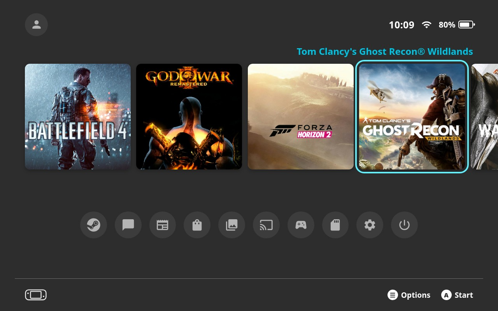
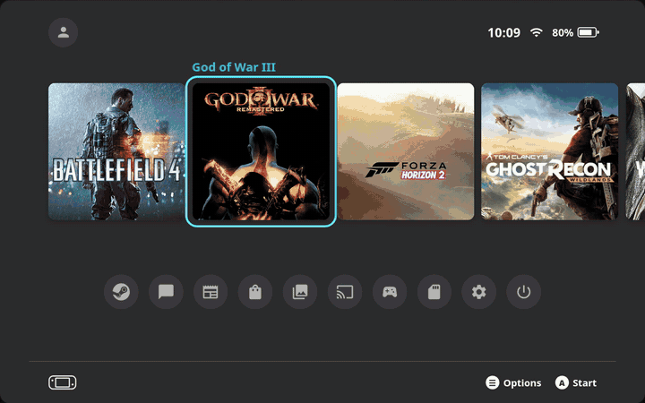
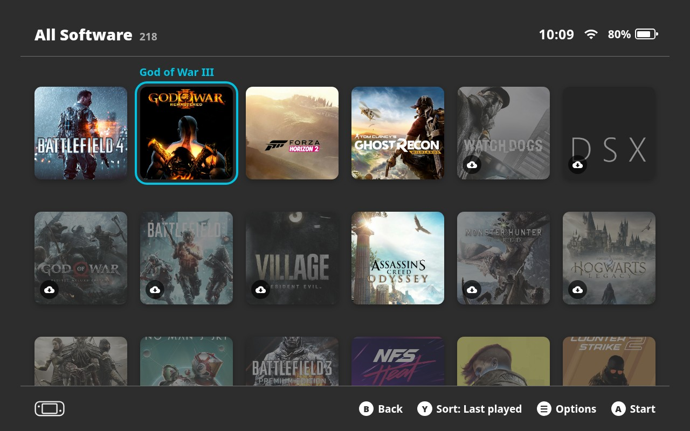
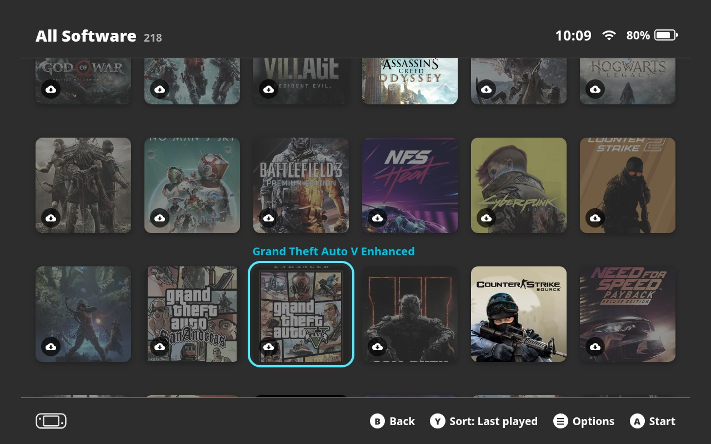
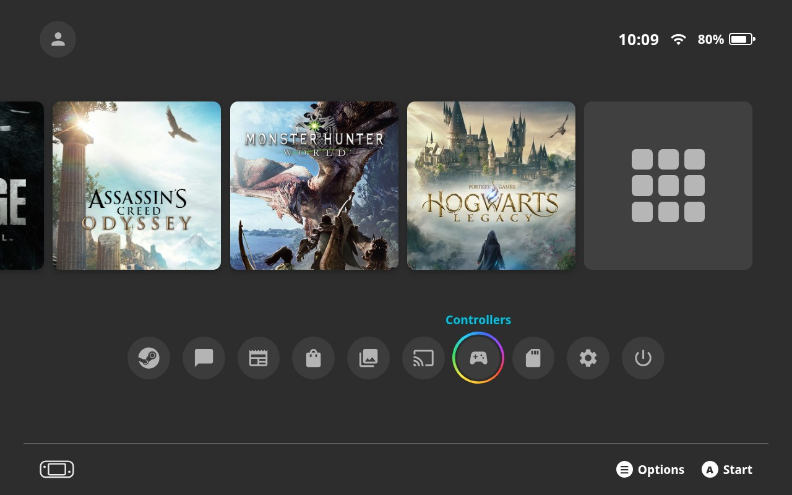
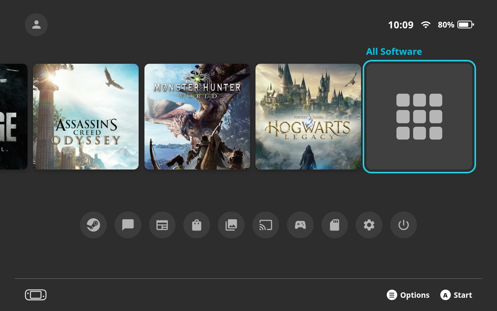
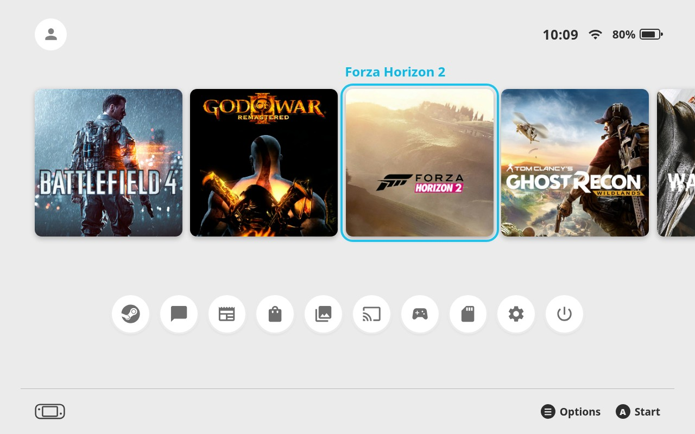
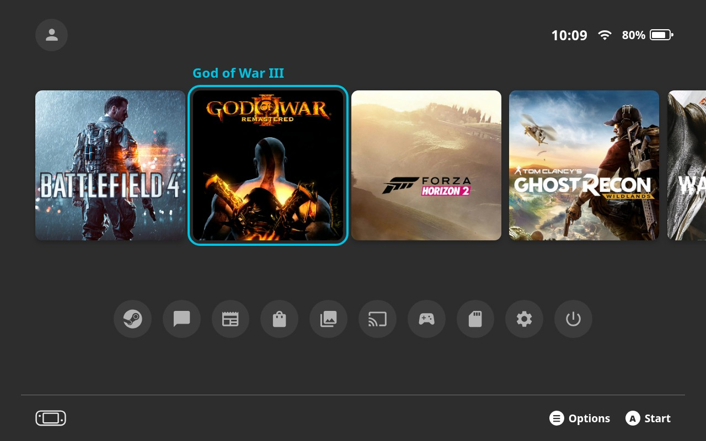
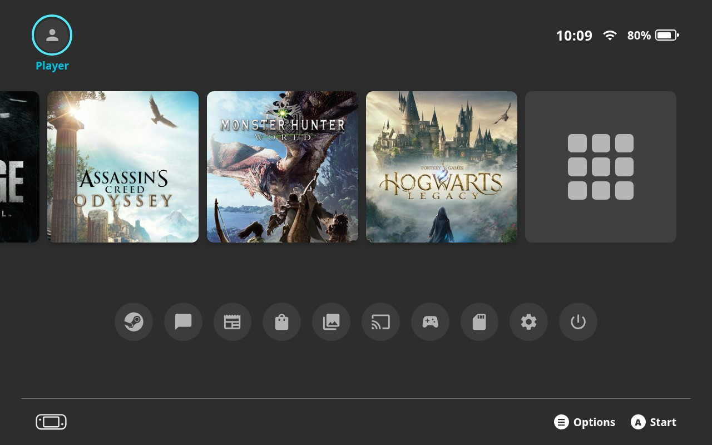

<div align="center">

# Switch 2 Dashboard

**Make SteamOS Game Mode look and feel like the Nintendo Switch 2 HOME Menu.**

A [Decky Loader](https://decky.xyz) plugin for the Steam Deck and other handhelds running SteamOS.

[](https://github.com/kromossomom-debug/decky-switch2-dashboard/releases/latest)
[](https://github.com/kromossomom-debug/decky-switch2-dashboard/releases)
[](LICENSE)
[](https://decky.xyz)
[](https://buymeacoffee.com/kromossomoc)





</div>

## Features

- **The HOME Menu layout.** Steam's home becomes the Switch 2 HOME Menu: a status bar on top, a row of big square
  tiles with your recently played games, ten round shortcut buttons under them and a footer with button hints.
- **Square game tiles.** Up to 12 recent games (4–20, your choice), most recent first, then **All Software**. The
  selected game's name sits above its tile in cyan, with a pulsing cyan frame around it. Long names slide left so they
  never run off the screen.
- **All Software screen.** Your whole library as a grid of square tiles, six to a row, like the console's. Games that
  aren't installed are dimmed with a cloud icon, like archived software. **Y** sorts by last played, play time or
  title; **B** goes back to the HOME Menu.
- **Ten round shortcuts, in the console's order,** each mapped to its closest Steam feature, with gray symbols and the
  rainbow selection ring:

  | Switch 2 | Switch 2 Dashboard |
  |---|---|
  | Nintendo Switch Online | **Steam Online** (Steam Community) |
  | GameChat | **Chat** (Friends & Chat) |
  | News | **News** (Steam news) |
  | Nintendo eShop | **Steam Store** |
  | Album | **Album** (screenshots and recordings) |
  | GameShare | **Remote Play** settings |
  | Controllers | **Controllers** settings |
  | Virtual Game Cards | **Library** |
  | System Settings | **System Settings** |
  | Sleep Mode | **Sleep Mode** (suspends right away) |

- **Status bar.** Your Steam avatar on the left (**My Page** opens your profile). The clock, Wi-Fi and battery level on
  the right are live: the battery turns green while charging and red when low.
- **Footer.** A handheld icon on the left and **☰ Options · A Start** on the right. Steam's own top and bottom bars
  are hidden on the HOME Menu only, and come back everywhere else.
- **Basic Black and Basic White themes,** like the console's.
- **Works with your art.** Custom covers from [SteamGridDB](https://github.com/SteamGridDB/decky-steamgriddb) and
  non-Steam games (emulators, shortcuts) show up like any other game.
- **English and Portuguese.** The plugin follows Steam's language.

## Screenshots

| | |
|:-:|:-:|
| <br>**All Software**: your whole library | <br>Games that aren't installed get a **cloud** |
| <br>**Round shortcuts** with the rainbow ring | <br>**All Software** at the end of the row |
| <br>**Basic White** theme | <br>**Non-Steam games** with custom art |
| <br>**My Page**, clock, Wi-Fi and battery | |

> These screenshots are rendered from the plugin's own stylesheet and icons at the Steam Deck's 1280×800 resolution,
> with the author's library as sample data (`demo/` has the scene and the renderer). Your avatar shows instead of the
> placeholder.

## Installation

### From the release ZIP

1. Install [Decky Loader](https://decky.xyz) if you haven't already.
2. Download **`switch2-dashboard.zip`** from the [latest release](https://github.com/kromossomom-debug/decky-switch2-dashboard/releases/latest)
   (it's also in the repository root: [`switch2-dashboard.zip`](switch2-dashboard.zip)).
3. In Game Mode, open **Quick Access (`…`) → Decky → ⚙ Settings → General** and turn on **Developer mode**.
4. Go to **Developer → Install plugin from ZIP** and pick `switch2-dashboard.zip`.
5. Open **Quick Access → Decky → Switch 2 Dashboard** to adjust it.

To update, install the new ZIP the same way. Your settings are kept.

> Use one dashboard at a time. If you also have **PS5 Dashboard**, **Xbox Dashboard** or a CSS Loader theme that
> restyles the home screen, turn its home screen off first, or they will fight over it.

## Controls

| Button | Where | Action |
|---|---|---|
| **A** | Game tile | Start the game (resume it if it's running, open its page if it isn't installed) |
| **A** | All Software tile | Open the All Software screen |
| **Y** | All Software screen | Sort: last played, play time, title |
| **B** | All Software screen | Back to the HOME Menu |
| **A** | Round shortcut | Open it |
| **☰** | Any game tile | Steam's game menu: Favorites, Manage, Properties, SteamGridDB's *Change artwork…* |
| **D-pad / stick** | Anywhere | Move between the avatar, the game row and the shortcuts |

## Settings

Everything lives in the plugin panel in Quick Access. Settings are saved to
`~/homebrew/settings/switch2-dashboard/settings.json`.

| Setting | What it does | Default |
|---|---|---|
| Switch 2 HOME Menu | Replaces Steam's home with the HOME Menu | On |
| Theme | Basic Black or Basic White | Basic Black |
| Tile art | Cover, banner or hero art, cropped to a square | Cover |
| Software in the row | How many recent games come before All Software (4–20) | 12 |
| Hide Steam's top and bottom bars | On the HOME Menu only; it draws its own status bar and hints | On |
| 24-hour clock | 24-hour or AM/PM | On |

## How it works

The HOME Menu replaces the `/library/home` route through Decky's router patching. If it ever fails to render, Steam's
own home is shown instead. All Software is a route of its own (`/switch2-dashboard/all-software`), so **B** and Steam's
back navigation work as usual. Games come from Steam's recent-games collection, artwork from Steam's own image cache
(custom SteamGridDB art first), and **☰** opens Steam's own `LibraryContextMenu`, which is why other plugins' menu
items show up in it.

Steam's CSS class names are hashed and change with client updates, so the plugin never hard-codes them. It finds
Steam's header and footer modules at runtime by their stable key names (`CurrentUserAvatar`, `Clock`, `BasicFooter`…)
and hides them only while the HOME Menu is actually on screen.

The clock, battery and Wi-Fi come from `SteamClient.System` and Steam's network store. Turning the plugin off or
uninstalling it puts Steam's home back.

## Building from source

Requirements: Node.js 18+ and npm.

```bash
git clone https://github.com/kromossomom-debug/decky-switch2-dashboard.git
cd decky-switch2-dashboard
npm install
npm run build
./scripts/package.sh   # creates switch2-dashboard.zip
```

```
src/
  index.tsx    plugin entry, Quick Access panel, route patch
  home.tsx     the HOME Menu: status bar, game row, round shortcuts, footer
  library.tsx  All Software: the library grid and its sort orders
  steam.ts     Steam data: recent games, artwork, launching, battery, network
  styles.ts    stylesheet for the HOME Menu
  i18n.ts      English and Portuguese text
  settings.ts  settings and defaults
main.py        Decky backend: settings
demo/          scene and renderer for the screenshots and the demo video
```

To re-render the screenshots: `node demo/build.mjs && node demo/record.mjs shots` (needs `puppeteer`).

## Known limitations

- A Steam client update can rename the modules the plugin relies on. Steam's bars may then stay visible on the HOME
  Menu until the plugin is updated. Nothing breaks: if the HOME Menu itself fails, Steam's home is shown.
- Steam has no square game art, so tiles crop the cover (or the banner or hero art, if you pick those).
- The console's sounds, font and logos are Nintendo's, so the plugin uses Steam's navigation sounds, Steam's font and
  generic icons.

## Support

If you enjoy the plugin, you can buy the author a coffee. It helps keep it updated. The plugin's panel in Quick Access
has a **Buy Me a Coffee** button too.

<a href="https://buymeacoffee.com/kromossomoc"></a>

Bug reports and ideas are welcome in [Issues](https://github.com/kromossomom-debug/decky-switch2-dashboard/issues).

## Disclaimer

This is an unofficial fan project. It is not affiliated with, endorsed by or sponsored by Nintendo or Valve. Nintendo
Switch is a trademark of Nintendo. Steam and Steam Deck are trademarks of Valve Corporation. The plugin contains no
Nintendo assets. Game artwork shown in the screenshots belongs to its respective owners.

## License

[MIT](LICENSE) © 2026 kromossomo
